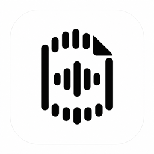

  
  <h1>SpeakNote · 随口记</h1>
  
<strong>在微信记待办，在 Mac 上接着做。</strong>

  
连接微信助手后，可以把待办和课表发到 Mac，和项目、日历一起管理。

  
<a href="https://github.com/CoderZHH/SpeakNote-Releases#readme"><strong>下载 Mac 版</strong></a> · <a href="https://github.com/CoderZHH/SpeakNote-Releases/releases">版本记录</a> · <a href="#从源码运行">从源码运行</a>

  
macOS 26+ · Apple Silicon / Intel · Apple 已公证 · MIT

## 在微信发一条待办

<picture>
  <source media="(prefers-reduced-motion: reduce)" srcset="assets/readme/wechat-to-mac.jpg">
  
</picture>

在微信发「帮我记个待办：周五交报告」，就能在 Mac 的「今日」查看这条任务。

要导入课表，发一张截图或 Excel `.xlsx`。助手会追问缺失的学期起始日、教学周或节次时间，发回预览。你确认后才写入课表。

| 你想做什么 | 在哪里做 |
| --- | --- |
| 随手记待办、梳理想法 | 「今日」和「思考」 |
| 看进度、安排时间、开始专注 | 「项目」「日历」和「今日」 |
| 管理学期、课程和上课安排 | 「课程」，可以手动添加或从微信导入 |

## 安装并连接微信

1. 下载并解压 [Mac 安装包](https://github.com/CoderZHH/SpeakNote-Releases#readme)，将 `SpeakNote.app` 拖到「应用程序」后打开。无需安装 Xcode。
2. 在首次引导中扫码绑定微信，填入并验证自己的 [DeepSeek API Key](https://platform.deepseek.com/api_keys)。验证成功后会自动打开工作台，也可以点「稍后连接」先进入工作台，再从侧栏配置微信助手。
3. 想接收微信消息时，保持随口记打开。需要暂停、重连或更换 Key 时，从侧栏进入「微信助手」。

> **预览版说明**　课表导入已通过本地解析与确认测试，真实微信附件收发仍待联调。

## 更新

打开 Mac 菜单栏的「随口记 → 检查更新…」，按提示安装新版。0.2.4 或更早版本先从[官方下载页](https://github.com/CoderZHH/SpeakNote-Releases#readme)下载并覆盖安装一次。

## 数据和备份

工作区保存在这台 Mac，预览版未启用 iCloud。DeepSeek Key 保存在 macOS 钥匙串。使用微信助手时，相关消息、附件内容和工作区上下文可能会发送给 DeepSeek。

「设置」支持导出和导入工作区记录，也可以手动导入 [示例工作区](docs/examples/workbench-demo-data.json)。JSON 导出不包含附件；要完整备份，请退出应用后备份整个数据目录，默认位于 `~/Library/Application Support/WorkBench Preview/`。

## 从源码运行

使用 Xcode 26 打开 [SpeakNote.xcodeproj](apple/SpeakNote.xcodeproj)，选择 `WorkBenchMac → My Mac`，点击 Run。

- [开发说明](apple/README.md) · [项目架构](docs/architecture.md)
- [MIT 许可证](LICENSE) · [第三方组件说明](THIRD_PARTY_NOTICES.md)
